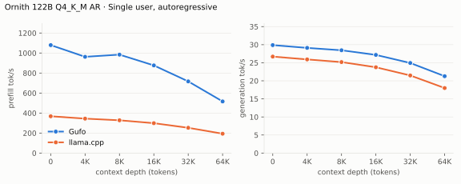
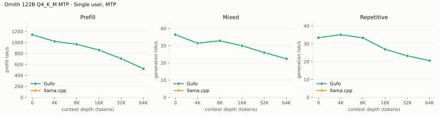
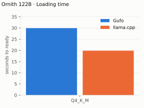
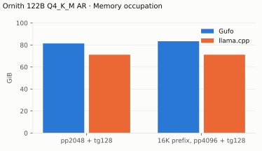

# Ornith 1.5 122B benchmarks

AMD Strix Halo `gfx1151`, 128 GB unified memory. Gufo versus llama.cpp
`68d9053a`, the revision Strycast pins, on `Ornith-1.5-122B-Q4_K_M.gguf`
([files and revisions](README.md)). HTTP through `tools/bench/model-bench.py`,
greedy, thinking off.

The Gufo rows were measured on October 29, 2026 with Strycast `03ba946d` (on
Gufo v0.26.0) built with the ROCm 10.1 toolchain Gufo pins. They replace
October 28 rows from the contributed branch (`d8535ed0`, host ROCm 7.2.2),
which lacked the K-quant GEMV decode change: prefill is now 1-16% faster and
decode 4-23% faster. Loading takes 30 s instead of 19 s and the server holds
about 4 GiB more, because Strycast loads the weights into device memory with
Gufo's own implementation
([gufo#708](https://github.com/gufo-org/gufo/pull/708)) rather than the
branch's; Strycast before the rebase (`87e3dcd0`, ROCm 7.2.3) measures the
same. The llama.cpp rows are the October 28 measurements, compiled with host
ROCm 7.2.2 and the pinned recipe's `--amdgpu-unroll-threshold-local=600` HIP
flag ([builds](artifacts/model-identities.json)).

Gufo drafts 2 MTP tokens from the GGUF's own MTP layer. llama.cpp's
`draft-mtp` loads the whole 72 GiB GGUF a second time as its draft model,
which does not fit in 128 GB, so its MTP cells are N/A.

Positive gain favors Gufo.
[Quality and measurement details](QUALITY.md)

## Single user, autoregressive

Approximately pp2048 / tg128; depth is the cached prefix in tokens. Depth
131,072 is not measured yet.

<!-- bench:single-ar-q4km -->
| Ornith 122B Q4_K_M AR Depth (tokens) | Gufo pp (tok/s) | llama.cpp pp (tok/s) | Gain | Gufo tg (tok/s) | llama.cpp tg (tok/s) | Gain |
| ---: | ---: | ---: | ---: | ---: | ---: | ---: |
| 0 | 1079.22 | 368.06 | +193.2% | 29.88 | 26.70 | +11.9% |
| 4,096 | 962.28 | 344.41 | +179.4% | 29.11 | 25.92 | +12.3% |
| 8,192 | 984.03 | 327.77 | +200.2% | 28.45 | 25.18 | +13.0% |
| 16,384 | 876.23 | 298.75 | +193.3% | 27.17 | 23.75 | +14.4% |
| 32,768 | 716.44 | 252.70 | +183.5% | 24.93 | 21.48 | +16.1% |
| 65,536 | 516.15 | 193.55 | +166.7% | 21.28 | 18.00 | +18.2% |
<!-- /bench -->

## Single user, MTP

Same workload as above with 2 MTP draft tokens. The mixed rows decode prose,
the repetitive rows copy text. On repetitive text MTP stops paying off
with depth: it is behind AR from 16,384 (20.54 against 21.28 tok/s at
65,536), while mixed decode stays ahead (22.41 at 65,536). llama.cpp's cells
are N/A because its `draft-mtp` loads the whole GGUF again as the draft model,
which does not fit.

<!-- bench:single-mtp-q4km -->
| Ornith 122B Q4_K_M MTP Depth (tokens) | Gufo pp (tok/s) | llama.cpp pp (tok/s) | Gain pp | Gufo tg mixed (tok/s) | llama.cpp tg mixed (tok/s) | Gain mixed | Gufo tg repetitive (tok/s) | llama.cpp tg repetitive (tok/s) | Gain repetitive |
| ---: | ---: | ---: | ---: | ---: | ---: | ---: | ---: | ---: | ---: |
| 0 | 1141.65 | N/A | N/A | 36.39 | N/A | N/A | 33.35 | N/A | N/A |
| 4,096 | 1020.14 | N/A | N/A | 31.45 | N/A | N/A | 35.04 | N/A | N/A |
| 8,192 | 966.20 | N/A | N/A | 32.86 | N/A | N/A | 33.27 | N/A | N/A |
| 16,384 | 861.85 | N/A | N/A | 29.98 | N/A | N/A | 26.87 | N/A | N/A |
| 32,768 | 706.00 | N/A | N/A | 25.99 | N/A | N/A | 23.21 | N/A | N/A |
| 65,536 | 521.29 | N/A | N/A | 22.41 | N/A | N/A | 20.54 | N/A | N/A |
<!-- /bench -->

## Loading time

<!-- bench:loading -->
| Ornith 122B Target | Gufo ready (s) | llama.cpp ready (s) | Gain |
| --- | ---: | ---: | ---: |
| Q4_K_M | 29.94 | 19.85 | -33.7% |
<!-- /bench -->

## Memory occupation

Gufo holds 10 to 12 GiB more than llama.cpp at these context settings.

<!-- bench:memory-q4km -->
| Ornith 122B Q4_K_M AR Workload | Gufo GiB | llama.cpp GiB | Gain |
| --- | ---: | ---: | ---: |
| pp2048 + tg128 | 81.39 | 71.15 | -12.6% |
| 16K prefix, pp4096 + tg128 | 83.39 | 71.15 | -14.7% |
<!-- /bench -->

## Earlier measurements

The sections below were measured October 21 to 23, 2026 on the gufo-org
#299 base, before the rebase onto Strycast, and are kept for the MTP and
weight-placement results they record.

### MTP draft depth

Fresh server per arm, six prompts of 256 tokens at temperature 0, thinking
off, 4 GiB RAM cache.

| Draft tokens | Median 256-token decode | Accepted |
| ---: | ---: | ---: |
| 2 | 8364 ms (30.6 t/s) | 1218 / 2162 (56.3%) |
| 3 | 8629 ms (29.7 t/s) | 1286 / 2614 (49.2%) |

Replies were identical across all arms. MTP-off tg128 on the same build was
about 27.3 t/s.

### Sampled requests with MTP

Six prompts of 256 tokens at temperature 0.6, top-p 0.95, top-k 20, fixed
seeds, thinking off; the 12-token first prompt is excluded. Median decode rate
after the first token.

| Build | Draft tokens | Decode (t/s) | Drafts accepted |
| --- | ---: | ---: | ---: |
| Without sampled proposals (no drafts) | 2 | 26.7 | none |
| With sampled proposals | 2 | 31.4 | 637 / 1102 (58%) |
| MTP off | | 27.8 | |

### First token after load

Three fresh loads per arm, eight chat requests each (six distinct prompts of
16 to 19 tokens, two exact repeats), MTP depth 2.

| Weights | Load | Uncached first token, median / p90 / max | Over 1 s |
| --- | ---: | ---: | ---: |
| Registered host copy | 29 to 35 s | 282 / 633 / 1077 ms | 2 of 18 |
| Device memory | 21 to 23 s | 285 / 356 / 497 ms | 0 of 18 |

With the registered copy, each slow request coincided with kernel compaction
migrating pages (up to 2.4 million pages in one 6 s stall). In those windows
one routed-expert GEMM that normally takes about 1 ms ran for 2 to 7 s. The
device-memory runs had 1.1 million pages migrated during their uncached
requests and no stall. Cache hits answered in 3 to 5 ms in both arms.

## Not measured

- Depth 131,072, single user.
- Concurrency above one session.
