# Qwen3.6 35B-A3B benchmarks

AMD Strix Halo `gfx1151`, 128 GB unified memory. Gufo (Strycast `03ba946d`,
on Gufo v0.26.0, ROCm 10.1 toolchain) versus llama.cpp `b11069` (`68d9053a`,
pinned ROCm 7.2.3 toolchain).
Targets are the Unsloth UD-Q4_K_XL / UD-Q6_K_XL / UD-Q8_K_XL files and the
lmstudio-community Q4_K_M; DFlash2 uses the aminya Q8_0 draft and MTP uses each
Unsloth target's own head (Q4_K_M has none) ([files and
revisions](README.md)). HTTP, greedy, thinking off.

Every Gufo row was measured on October 29, 2026, after the rebase onto Gufo
v0.26.0 and its switch to ROCm 10.1. Against the October 25 and 27 rows from
the 7.2.3 build, prefill gained about 5% at pp2048, shrinking to about 1% lower
at 131,072; plain decode stayed within 2%, except Q4_K_M, which gained about 6%
from the K-quant GEMV decode change merged since. Loading takes about 1 s longer
because the weights are now read into device memory instead of mapped
([gufo#708](https://github.com/gufo-org/gufo/pull/708)). The llama.cpp rows are the October 25 and 27 measurements
([builds](artifacts/model-identities.json)).

Gufo drafts up to 7 DFlash2 tokens with its adaptive controller and 2 MTP
tokens; llama.cpp uses its default of 3 for both modes. Its repetitive MTP
rows therefore accept up to 2.88 tokens per step against Gufo's 1.91.

Every Gufo DFlash2 and MTP completion, single-user at every depth and
multi-user at every level, matches Gufo AR on every target, and every
multi-user AR completion matches the same prompt decoded alone (see
[Quality](QUALITY.md#benchmark-output-consistency)).

Positive gain favors Gufo.
[Quality and measurement details](QUALITY.md) · [Model identities](artifacts/model-identities.json)

## Single user, autoregressive

Approximately pp2048 / tg128; depth is the cached prefix in tokens.

<!-- bench:single-ar-q4 -->
| Qwen35B-A3B Q4 AR Depth (tokens) | Gufo pp (tok/s) | llama.cpp pp (tok/s) | Gain | Gufo tg (tok/s) | llama.cpp tg (tok/s) | Gain |
| ---: | ---: | ---: | ---: | ---: | ---: | ---: |
| 0 | 3400.57 | 1406.89 | +141.7% | 61.09 | 52.88 | +15.5% |
| 4,096 | 3088.64 | 1292.78 | +138.9% | 59.43 | 51.45 | +15.5% |
| 8,192 | 2881.74 | 1198.97 | +140.4% | 58.26 | 50.44 | +15.5% |
| 12,288 | 2630.92 | 1116.84 | +135.6% | 56.91 | 49.38 | +15.2% |
| 16,384 | 2458.61 | 1049.84 | +134.2% | 55.98 | 48.43 | +15.6% |
| 32,768 | 1947.51 | 846.06 | +130.2% | 51.81 | 45.13 | +14.8% |
| 65,536 | 1403.82 | 611.04 | +129.7% | 45.10 | 39.44 | +14.4% |
| 131,072 | 890.15 | 395.50 | +125.1% | 35.84 | 31.57 | +13.5% |
<!-- /bench -->

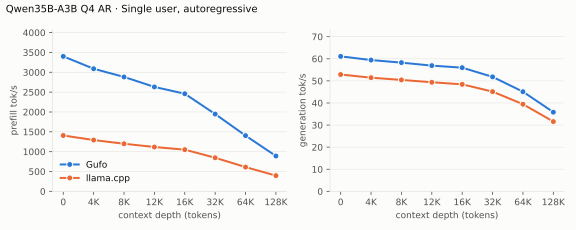

---

<!-- bench:single-ar-q6 -->
| Qwen35B-A3B Q6 AR Depth (tokens) | Gufo pp (tok/s) | llama.cpp pp (tok/s) | Gain | Gufo tg (tok/s) | llama.cpp tg (tok/s) | Gain |
| ---: | ---: | ---: | ---: | ---: | ---: | ---: |
| 0 | 3243.22 | 1244.48 | +160.6% | 55.98 | 47.99 | +16.6% |
| 4,096 | 2990.91 | 1175.64 | +154.4% | 54.65 | 47.49 | +15.1% |
| 8,192 | 2775.82 | 1100.87 | +152.1% | 53.68 | 46.87 | +14.5% |
| 12,288 | 2532.82 | 1034.19 | +144.9% | 52.47 | 45.94 | +14.2% |
| 16,384 | 2363.99 | 976.90 | +142.0% | 51.58 | 45.13 | +14.3% |
| 32,768 | 1891.16 | 797.00 | +137.3% | 48.17 | 42.17 | +14.2% |
| 65,536 | 1362.09 | 583.86 | +133.3% | 42.24 | 37.11 | +13.8% |
| 131,072 | 873.96 | 385.23 | +126.9% | 34.09 | 30.13 | +13.1% |
<!-- /bench -->

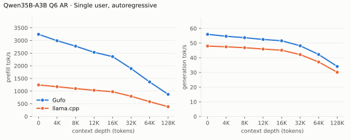

---

<!-- bench:single-ar-q8 -->
| Qwen35B-A3B Q8 AR Depth (tokens) | Gufo pp (tok/s) | llama.cpp pp (tok/s) | Gain | Gufo tg (tok/s) | llama.cpp tg (tok/s) | Gain |
| ---: | ---: | ---: | ---: | ---: | ---: | ---: |
| 0 | 2985.14 | 1285.34 | +132.2% | 52.14 | 45.77 | +13.9% |
| 4,096 | 2770.28 | 1156.16 | +139.6% | 50.85 | 45.04 | +12.9% |
| 8,192 | 2586.34 | 1096.24 | +135.9% | 50.12 | 44.23 | +13.3% |
| 12,288 | 2400.94 | 1002.01 | +139.6% | 49.14 | 44.06 | +11.5% |
| 16,384 | 2248.94 | 950.59 | +136.6% | 48.44 | 43.32 | +11.8% |
| 32,768 | 1819.51 | 774.25 | +135.0% | 45.23 | 40.57 | +11.5% |
| 65,536 | 1323.90 | 574.61 | +130.4% | 39.92 | 35.80 | +11.5% |
| 131,072 | 856.64 | 377.60 | +126.9% | 32.55 | 29.32 | +11.0% |
<!-- /bench -->

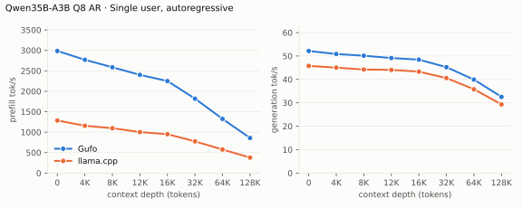

---

<!-- bench:single-ar-q4km -->
| Qwen35B-A3B Q4_K_M AR Depth (tokens) | Gufo pp (tok/s) | llama.cpp pp (tok/s) | Gain | Gufo tg (tok/s) | llama.cpp tg (tok/s) | Gain |
| ---: | ---: | ---: | ---: | ---: | ---: | ---: |
| 0 | 3279.28 | 1344.48 | +143.9% | 74.89 | 62.61 | +19.6% |
| 4,096 | 3026.17 | 1239.47 | +144.2% | 72.35 | 61.34 | +17.9% |
| 8,192 | 2794.29 | 1152.16 | +142.5% | 70.65 | 60.29 | +17.2% |
| 12,288 | 2546.79 | 1084.03 | +134.9% | 68.44 | 58.67 | +16.7% |
| 16,384 | 2399.77 | 1020.81 | +135.1% | 66.89 | 57.42 | +16.5% |
| 32,768 | 1913.49 | 827.87 | +131.1% | 61.22 | 52.52 | +16.6% |
| 65,536 | 1372.73 | 599.07 | +129.1% | 52.01 | 45.13 | +15.2% |
| 131,072 | 879.49 | 393.85 | +123.3% | 40.15 | 35.15 | +14.2% |
<!-- /bench -->

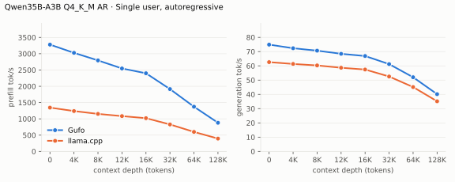

## Single user, DFlash2

pp is the highest measured rate per engine and depth across mixed/repetitive
text.

<!-- bench:single-dflash2-q4 -->
| Qwen35B-A3B Q4 DFlash2 Depth (tokens) | Gufo pp (tok/s) | llama.cpp pp (tok/s) | Gain pp | Gufo tg mixed (tok/s) | llama.cpp tg mixed (tok/s) | Gain mixed | Gufo tg repetitive (tok/s) | llama.cpp tg repetitive (tok/s) | Gain repetitive |
| ---: | ---: | ---: | ---: | ---: | ---: | ---: | ---: | ---: | ---: |
| 0 | 3146.93 | 1307.78 | +140.6% | 81.87 | 71.68 | +14.2% | 218.56 | 110.69 | +97.5% |
| 4,096 | 2753.64 | 1194.36 | +130.6% | 79.36 | 66.59 | +19.2% | 204.72 | 105.10 | +94.8% |
| 8,192 | 2606.21 | 1113.55 | +134.0% | 74.77 | 70.38 | +6.2% | 201.10 | 106.50 | +88.8% |
| 12,288 | 2424.98 | 1041.80 | +132.8% | 80.54 | 75.74 | +6.3% | 198.63 | 101.82 | +95.1% |
| 16,384 | 2292.60 | 981.11 | +133.7% | 73.37 | 66.16 | +10.9% | 171.35 | 102.91 | +66.5% |
| 32,768 | 1838.97 | 808.49 | +127.5% | 64.46 | 58.36 | +10.5% | 175.52 | 98.85 | +77.6% |
| 65,536 | 1342.96 | 589.76 | +127.7% | 56.78 | 58.65 | -3.2% | 146.67 | 79.62 | +84.2% |
| 131,072 | 856.69 | 383.37 | +123.5% | 50.04 | 46.40 | +7.8% | 120.69 | 59.31 | +103.5% |
<!-- /bench -->

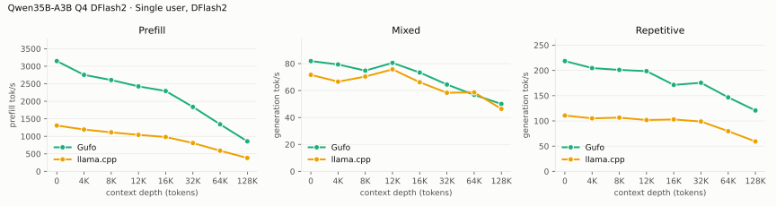

---

<!-- bench:single-dflash2-q6 -->
| Qwen35B-A3B Q6 DFlash2 Depth (tokens) | Gufo pp (tok/s) | llama.cpp pp (tok/s) | Gain pp | Gufo tg mixed (tok/s) | llama.cpp tg mixed (tok/s) | Gain mixed | Gufo tg repetitive (tok/s) | llama.cpp tg repetitive (tok/s) | Gain repetitive |
| ---: | ---: | ---: | ---: | ---: | ---: | ---: | ---: | ---: | ---: |
| 0 | 3004.80 | 1188.48 | +152.8% | 72.58 | 66.03 | +9.9% | 189.21 | 98.96 | +91.2% |
| 4,096 | 2675.82 | 1088.76 | +145.8% | 69.91 | 62.49 | +11.9% | 177.22 | 93.12 | +90.3% |
| 8,192 | 2468.07 | 1024.31 | +140.9% | 73.65 | 55.28 | +33.2% | 174.65 | 94.95 | +83.9% |
| 12,288 | 2322.44 | 963.31 | +141.1% | 68.08 | 61.68 | +10.4% | 172.99 | 91.62 | +88.8% |
| 16,384 | 2186.79 | 907.46 | +141.0% | 70.91 | 59.35 | +19.5% | 159.57 | 90.74 | +75.9% |
| 32,768 | 1768.09 | 760.81 | +132.4% | 59.52 | 53.51 | +11.2% | 155.20 | 90.82 | +70.9% |
| 65,536 | 1295.28 | 563.69 | +129.8% | 55.98 | 47.62 | +17.6% | 130.01 | 73.87 | +76.0% |
| 131,072 | 835.23 | 373.09 | +123.9% | 50.46 | 43.47 | +16.1% | 110.39 | 55.46 | +99.0% |
<!-- /bench -->

---

<!-- bench:single-dflash2-q8 -->
| Qwen35B-A3B Q8 DFlash2 Depth (tokens) | Gufo pp (tok/s) | llama.cpp pp (tok/s) | Gain pp | Gufo tg mixed (tok/s) | llama.cpp tg mixed (tok/s) | Gain mixed | Gufo tg repetitive (tok/s) | llama.cpp tg repetitive (tok/s) | Gain repetitive |
| ---: | ---: | ---: | ---: | ---: | ---: | ---: | ---: | ---: | ---: |
| 0 | 2780.14 | 1212.36 | +129.3% | 69.80 | 63.24 | +10.4% | 176.20 | 90.83 | +94.0% |
| 4,096 | 2536.77 | 1110.30 | +128.5% | 62.60 | 61.97 | +1.0% | 164.25 | 86.48 | +89.9% |
| 8,192 | 2378.84 | 1024.27 | +132.2% | 71.52 | 56.42 | +26.8% | 164.36 | 86.62 | +89.7% |
| 12,288 | 2214.06 | 965.17 | +129.4% | 69.26 | 63.03 | +9.9% | 161.94 | 83.94 | +92.9% |
| 16,384 | 2095.66 | 908.96 | +130.6% | 65.88 | 58.73 | +12.2% | 149.30 | 85.59 | +74.4% |
| 32,768 | 1705.56 | 755.08 | +125.9% | 57.33 | 52.81 | +8.6% | 145.81 | 83.36 | +74.9% |
| 65,536 | 1270.00 | 561.23 | +126.3% | 50.52 | 47.03 | +7.4% | 123.22 | 68.52 | +79.8% |
| 131,072 | 822.22 | 371.68 | +121.2% | 46.90 | 41.63 | +12.7% | 105.71 | 52.15 | +102.7% |
<!-- /bench -->

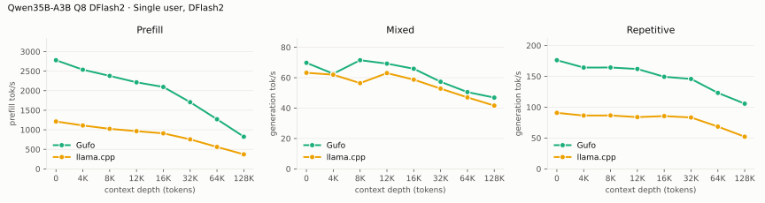

---

<!-- bench:single-dflash2-q4km -->
| Qwen35B-A3B Q4_K_M DFlash2 Depth (tokens) | Gufo pp (tok/s) | llama.cpp pp (tok/s) | Gain pp | Gufo tg mixed (tok/s) | llama.cpp tg mixed (tok/s) | Gain mixed | Gufo tg repetitive (tok/s) | llama.cpp tg repetitive (tok/s) | Gain repetitive |
| ---: | ---: | ---: | ---: | ---: | ---: | ---: | ---: | ---: | ---: |
| 0 | 3026.06 | 1266.45 | +138.9% | 81.25 | 82.15 | -1.1% | 234.17 | 120.43 | +94.4% |
| 4,096 | 2732.26 | 1167.48 | +134.0% | 77.63 | 66.06 | +17.5% | 216.80 | 108.15 | +100.5% |
| 8,192 | 2511.89 | 1080.28 | +132.5% | 74.67 | 66.09 | +13.0% | 216.17 | 108.83 | +98.6% |
| 12,288 | 2360.26 | 1013.29 | +132.9% | 79.52 | 73.40 | +8.3% | 212.67 | 102.92 | +106.6% |
| 16,384 | 2222.10 | 958.40 | +131.9% | 84.79 | 68.65 | +23.5% | 186.80 | 105.18 | +77.6% |
| 32,768 | 1801.27 | 793.40 | +127.0% | 75.46 | 65.11 | +15.9% | 188.16 | 101.86 | +84.7% |
| 65,536 | 1319.61 | 581.57 | +126.9% | 69.53 | 61.47 | +13.1% | 153.22 | 78.58 | +95.0% |
| 131,072 | 844.01 | 381.70 | +121.1% | 63.32 | 47.25 | +34.0% | 126.83 | 65.09 | +94.9% |
<!-- /bench -->

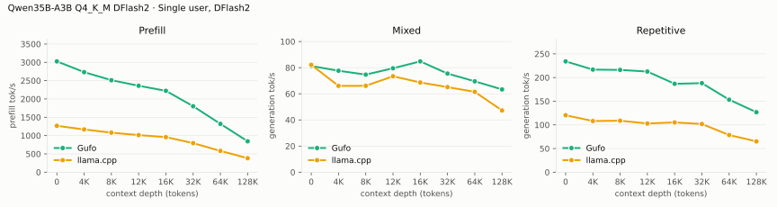

## Single user, MTP

The GGUF's own MTP head on both engines. pp is the highest measured rate per
engine and depth across mixed/repetitive text.

<!-- bench:single-mtp-q4 -->
| Qwen35B-A3B Q4 MTP Depth (tokens) | Gufo pp (tok/s) | llama.cpp pp (tok/s) | Gain pp | Gufo tg mixed (tok/s) | llama.cpp tg mixed (tok/s) | Gain mixed | Gufo tg repetitive (tok/s) | llama.cpp tg repetitive (tok/s) | Gain repetitive |
| ---: | ---: | ---: | ---: | ---: | ---: | ---: | ---: | ---: | ---: |
| 0 | 3381.55 | 1353.27 | +149.9% | 80.41 | 71.58 | +12.3% | 106.36 | 106.80 | -0.4% |
| 4,096 | 3027.98 | 1215.60 | +149.1% | 79.37 | 70.78 | +12.1% | 103.87 | 103.84 | +0.0% |
| 8,192 | 2809.55 | 1108.04 | +153.6% | 82.35 | 71.83 | +14.6% | 100.51 | 101.56 | -1.0% |
| 12,288 | 2564.41 | 1032.26 | +148.4% | 81.72 | 67.19 | +21.6% | 97.44 | 99.91 | -2.5% |
| 16,384 | 2407.64 | 966.42 | +149.1% | 74.95 | 69.09 | +8.5% | 95.48 | 98.58 | -3.1% |
| 32,768 | 1917.88 | 780.33 | +145.8% | 72.38 | 56.30 | +28.6% | 87.35 | 91.41 | -4.4% |
| 65,536 | 1367.86 | 558.58 | +144.9% | 56.50 | 51.16 | +10.4% | 74.05 | 77.66 | -4.6% |
| 131,072 | 868.25 | 358.22 | +142.4% | 40.24 | 42.46 | -5.2% | 55.36 | 62.78 | -11.8% |
<!-- /bench -->

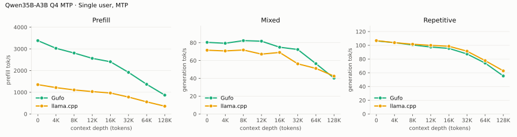

---

<!-- bench:single-mtp-q6 -->
| Qwen35B-A3B Q6 MTP Depth (tokens) | Gufo pp (tok/s) | llama.cpp pp (tok/s) | Gain pp | Gufo tg mixed (tok/s) | llama.cpp tg mixed (tok/s) | Gain mixed | Gufo tg repetitive (tok/s) | llama.cpp tg repetitive (tok/s) | Gain repetitive |
| ---: | ---: | ---: | ---: | ---: | ---: | ---: | ---: | ---: | ---: |
| 0 | 3200.04 | 1229.36 | +160.3% | 70.85 | 55.92 | +26.7% | 97.10 | 95.74 | +1.4% |
| 4,096 | 2889.03 | 1103.94 | +161.7% | 74.85 | 64.00 | +17.0% | 94.72 | 92.96 | +1.9% |
| 8,192 | 2623.67 | 1018.04 | +157.7% | 72.65 | 64.82 | +12.1% | 92.00 | 90.98 | +1.1% |
| 12,288 | 2439.12 | 958.12 | +154.6% | 69.92 | 57.52 | +21.6% | 89.59 | 88.10 | +1.7% |
| 16,384 | 2286.28 | 895.61 | +155.3% | 73.60 | 63.87 | +15.2% | 88.77 | 88.42 | +0.4% |
| 32,768 | 1855.35 | 736.49 | +151.9% | 64.57 | 56.45 | +14.4% | 80.83 | 82.56 | -2.1% |
| 65,536 | 1337.18 | 536.13 | +149.4% | 55.58 | 46.05 | +20.7% | 69.25 | 72.56 | -4.6% |
| 131,072 | 856.44 | 346.69 | +147.0% | 41.87 | 36.02 | +16.2% | 52.46 | 57.91 | -9.4% |
<!-- /bench -->

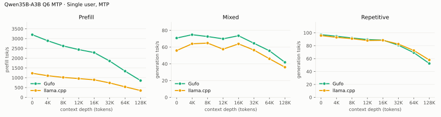

---

<!-- bench:single-mtp-q8 -->
| Qwen35B-A3B Q8 MTP Depth (tokens) | Gufo pp (tok/s) | llama.cpp pp (tok/s) | Gain pp | Gufo tg mixed (tok/s) | llama.cpp tg mixed (tok/s) | Gain mixed | Gufo tg repetitive (tok/s) | llama.cpp tg repetitive (tok/s) | Gain repetitive |
| ---: | ---: | ---: | ---: | ---: | ---: | ---: | ---: | ---: | ---: |
| 0 | 2952.94 | 1254.59 | +135.4% | 63.94 | 59.00 | +8.4% | 88.37 | 88.43 | -0.1% |
| 4,096 | 2678.25 | 1138.95 | +135.2% | 64.81 | 60.48 | +7.2% | 86.81 | 86.43 | +0.4% |
| 8,192 | 2524.45 | 1020.49 | +147.4% | 68.53 | 59.78 | +14.6% | 84.25 | 85.00 | -0.9% |
| 12,288 | 2325.89 | 956.13 | +143.3% | 63.25 | 53.75 | +17.7% | 81.78 | 83.53 | -2.1% |
| 16,384 | 2191.23 | 894.66 | +144.9% | 67.90 | 58.97 | +15.1% | 81.18 | 82.95 | -2.1% |
| 32,768 | 1780.30 | 731.51 | +143.4% | 59.89 | 54.15 | +10.6% | 74.67 | 77.29 | -3.4% |
| 65,536 | 1308.68 | 528.60 | +147.6% | 49.64 | 45.34 | +9.5% | 64.91 | 67.10 | -3.3% |
| 131,072 | 841.08 | 346.35 | +142.8% | 38.08 | 36.09 | +5.5% | 49.98 | 54.62 | -8.5% |
<!-- /bench -->

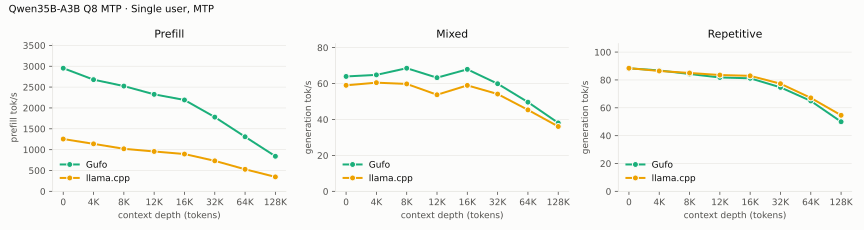

## Multiple users, autoregressive

Same pp2048 prose prompt as single-user d0, tg128, context 4096 per user.
Every session is prefilled before timed decoding; throughput sums individual
request decode rates.

<!-- bench:multi-ar-q4 -->
| Qwen35B-A3B Q4 AR Users | Gufo AR (tok/s) | llama.cpp AR (tok/s) | Gain |
| ---: | ---: | ---: | ---: |
| 1 | 61.03 | 52.81 | +15.6% |
| 2 | 105.56 | 85.42 | +23.6% |
| 4 | 169.82 | 136.37 | +24.5% |
| 6 | 212.93 | 150.53 | +41.5% |
| 8 | 239.53 | 170.00 | +40.9% |
<!-- /bench -->

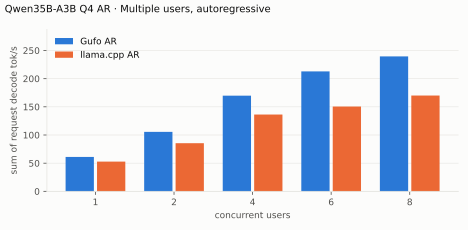

---

<!-- bench:multi-ar-q6 -->
| Qwen35B-A3B Q6 AR Users | Gufo AR (tok/s) | llama.cpp AR (tok/s) | Gain |
| ---: | ---: | ---: | ---: |
| 1 | 55.90 | 48.24 | +15.9% |
| 2 | 95.54 | 81.70 | +16.9% |
| 4 | 147.98 | 124.43 | +18.9% |
| 6 | 181.34 | 138.28 | +31.1% |
| 8 | 204.87 | 148.36 | +38.1% |
<!-- /bench -->

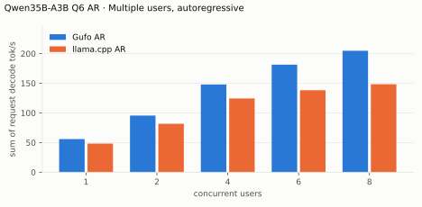

---

<!-- bench:multi-ar-q8 -->
| Qwen35B-A3B Q8 AR Users | Gufo AR (tok/s) | llama.cpp AR (tok/s) | Gain |
| ---: | ---: | ---: | ---: |
| 1 | 52.10 | 46.52 | +12.0% |
| 2 | 90.42 | 71.36 | +26.7% |
| 4 | 149.28 | 106.06 | +40.8% |
| 6 | 189.83 | 125.10 | +51.7% |
| 8 | 220.98 | 142.36 | +55.2% |
<!-- /bench -->

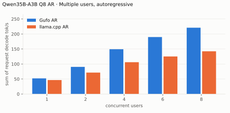

---

<!-- bench:multi-ar-q4km -->
| Qwen35B-A3B Q4_K_M AR Users | Gufo AR (tok/s) | llama.cpp AR (tok/s) | Gain |
| ---: | ---: | ---: | ---: |
| 1 | 74.77 | 62.69 | +19.3% |
| 2 | 124.39 | 104.16 | +19.4% |
| 4 | 197.83 | 147.29 | +34.3% |
| 6 | 237.82 | 150.19 | +58.3% |
| 8 | 251.49 | 166.23 | +51.3% |
<!-- /bench -->

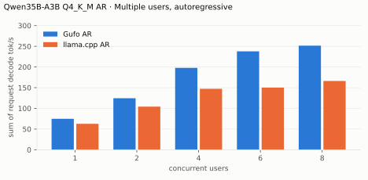

## Multiple users, DFlash2

Same pp2048 mixed/repetitive prompts as single-user d0, tg128, context 4096
per user. Every session is prefilled before timed decoding.

<!-- bench:multi-dflash2-q4 -->
| Qwen35B-A3B Q4 DFlash2 Users | Gufo mixed (tok/s) | llama.cpp mixed (tok/s) | Gain | Gufo repetitive (tok/s) | llama.cpp repetitive (tok/s) | Gain |
| ---: | ---: | ---: | ---: | ---: | ---: | ---: |
| 1 | 81.69 | 71.29 | +14.6% | 217.25 | 109.64 | +98.1% |
| 2 | 117.59 | 97.96 | +20.0% | 205.59 | 151.40 | +35.8% |
| 4 | 165.17 | 130.69 | +26.4% | 232.92 | 163.99 | +42.0% |
| 6 | 174.57 | 152.11 | +14.8% | 242.43 | 199.36 | +21.6% |
| 8 | 192.35 | 166.10 | +15.8% | 269.74 | 227.83 | +18.4% |
<!-- /bench -->

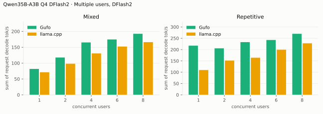

---

<!-- bench:multi-dflash2-q6 -->
| Qwen35B-A3B Q6 DFlash2 Users | Gufo mixed (tok/s) | llama.cpp mixed (tok/s) | Gain | Gufo repetitive (tok/s) | llama.cpp repetitive (tok/s) | Gain |
| ---: | ---: | ---: | ---: | ---: | ---: | ---: |
| 1 | 72.20 | 67.80 | +6.5% | 187.44 | 99.51 | +88.4% |
| 2 | 107.87 | 87.30 | +23.6% | 172.63 | 133.80 | +29.0% |
| 4 | 140.62 | 123.51 | +13.9% | 202.34 | 156.25 | +29.5% |
| 6 | 147.54 | 148.31 | -0.5% | 205.90 | 186.66 | +10.3% |
| 8 | 161.70 | 158.16 | +2.2% | 224.75 | 207.36 | +8.4% |
<!-- /bench -->

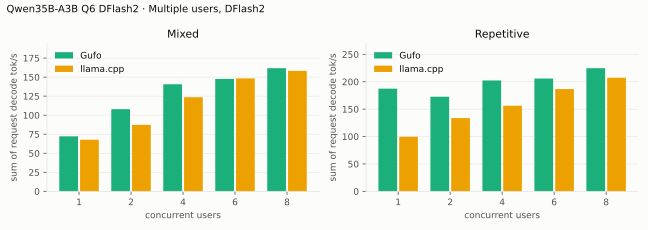

---

<!-- bench:multi-dflash2-q8 -->
| Qwen35B-A3B Q8 DFlash2 Users | Gufo mixed (tok/s) | llama.cpp mixed (tok/s) | Gain | Gufo repetitive (tok/s) | llama.cpp repetitive (tok/s) | Gain |
| ---: | ---: | ---: | ---: | ---: | ---: | ---: |
| 1 | 69.53 | 62.75 | +10.8% | 175.51 | 89.99 | +95.0% |
| 2 | 112.33 | 81.50 | +37.8% | 170.28 | 142.68 | +19.3% |
| 4 | 152.16 | 113.51 | +34.0% | 190.93 | 147.69 | +29.3% |
| 6 | 162.27 | 126.99 | +27.8% | 215.27 | 173.99 | +23.7% |
| 8 | 181.81 | 147.45 | +23.3% | 242.49 | 189.30 | +28.1% |
<!-- /bench -->

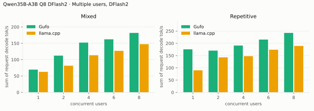

---

<!-- bench:multi-dflash2-q4km -->
| Qwen35B-A3B Q4_K_M DFlash2 Users | Gufo mixed (tok/s) | llama.cpp mixed (tok/s) | Gain | Gufo repetitive (tok/s) | llama.cpp repetitive (tok/s) | Gain |
| ---: | ---: | ---: | ---: | ---: | ---: | ---: |
| 1 | 80.86 | 81.52 | -0.8% | 233.39 | 116.07 | +101.1% |
| 2 | 136.75 | 100.15 | +36.5% | 237.77 | 127.96 | +85.8% |
| 4 | 173.05 | 134.69 | +28.5% | 234.26 | 181.30 | +29.2% |
| 6 | 180.01 | 165.46 | +8.8% | 245.09 | 216.98 | +13.0% |
| 8 | 198.46 | 166.60 | +19.1% | 279.86 | 231.36 | +21.0% |
<!-- /bench -->

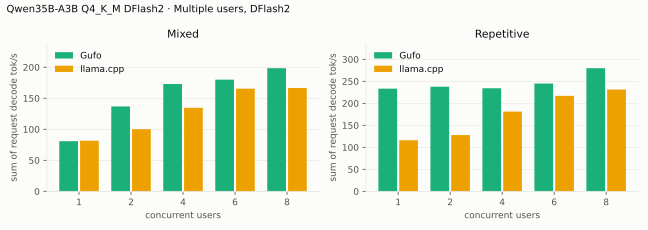

## Multiple users, MTP

Same prompts and method as the DFlash2 table.

<!-- bench:multi-mtp-q4 -->
| Qwen35B-A3B Q4 MTP Users | Gufo mixed (tok/s) | llama.cpp mixed (tok/s) | Gain | Gufo repetitive (tok/s) | llama.cpp repetitive (tok/s) | Gain |
| ---: | ---: | ---: | ---: | ---: | ---: | ---: |
| 1 | 79.45 | 71.01 | +11.9% | 104.99 | 106.69 | -1.6% |
| 2 | 125.05 | 96.44 | +29.7% | 140.71 | 116.20 | +21.1% |
| 4 | 159.30 | 130.00 | +22.5% | 164.00 | 125.09 | +31.1% |
| 6 | 203.46 | 151.92 | +33.9% | 194.53 | 134.24 | +44.9% |
| 8 | 228.17 | 171.86 | +32.8% | 227.76 | 146.10 | +55.9% |
<!-- /bench -->

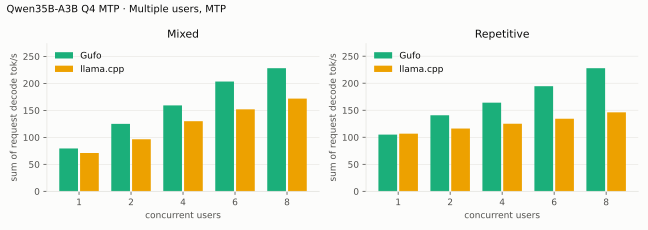

---

<!-- bench:multi-mtp-q6 -->
| Qwen35B-A3B Q6 MTP Users | Gufo mixed (tok/s) | llama.cpp mixed (tok/s) | Gain | Gufo repetitive (tok/s) | llama.cpp repetitive (tok/s) | Gain |
| ---: | ---: | ---: | ---: | ---: | ---: | ---: |
| 1 | 70.11 | 59.63 | +17.6% | 95.90 | 95.81 | +0.1% |
| 2 | 105.91 | 92.55 | +14.4% | 121.30 | 100.17 | +21.1% |
| 4 | 143.70 | 110.24 | +30.4% | 142.73 | 128.68 | +10.9% |
| 6 | 175.70 | 136.14 | +29.1% | 175.47 | 113.82 | +54.2% |
| 8 | 196.88 | 143.40 | +37.3% | 196.99 | 134.93 | +46.0% |
<!-- /bench -->

---

<!-- bench:multi-mtp-q8 -->
| Qwen35B-A3B Q8 MTP Users | Gufo mixed (tok/s) | llama.cpp mixed (tok/s) | Gain | Gufo repetitive (tok/s) | llama.cpp repetitive (tok/s) | Gain |
| ---: | ---: | ---: | ---: | ---: | ---: | ---: |
| 1 | 63.44 | 59.64 | +6.4% | 87.42 | 88.41 | -1.1% |
| 2 | 104.46 | 81.48 | +28.2% | 119.86 | 91.26 | +31.3% |
| 4 | 144.59 | 107.25 | +34.8% | 144.56 | 107.06 | +35.0% |
| 6 | 182.33 | 129.17 | +41.2% | 171.44 | 109.75 | +56.2% |
| 8 | 211.34 | 144.96 | +45.8% | 199.68 | 126.52 | +57.8% |
<!-- /bench -->

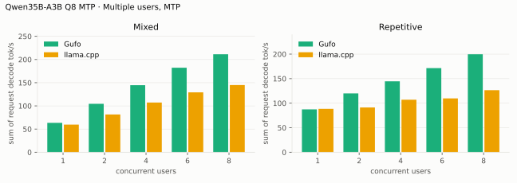

## Loading time

C1, context capacity 133760, DFlash2. Cold target/draft files to HTTP readiness.

<!-- bench:loading -->
| Qwen35B-A3B Target | Gufo ready (s) | llama.cpp ready (s) | Gain |
| --- | ---: | ---: | ---: |
| Q4 | 11.02 | 9.62 | -12.7% |
| Q6 | 15.41 | 13.23 | -14.1% |
| Q8 | 18.14 | 15.37 | -15.3% |
| Q4_K_M | 10.60 | 9.53 | -10.1% |
<!-- /bench -->

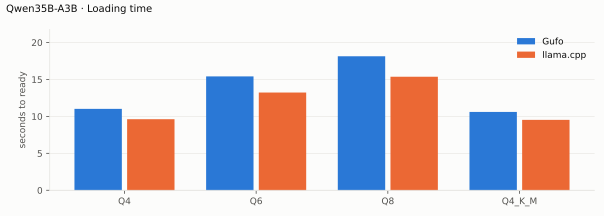

## Memory occupation

C1, context capacity 133760, AR. Peak memory reported by HIP. llama-server
allocates its KV cache up front, so its peak does not grow with the prefix.

<!-- bench:memory-q4 -->
| Qwen35B-A3B Q4 AR Workload | Gufo GiB | llama.cpp GiB | Gain |
| --- | ---: | ---: | ---: |
| pp2048 + tg128 | 31.61 | 26.64 | -15.7% |
| 16K prefix, pp4096 + tg128 | 32.61 | 26.81 | -17.8% |
<!-- /bench -->

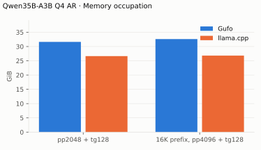

---

<!-- bench:memory-q6 -->
| Qwen35B-A3B Q6 AR Workload | Gufo GiB | llama.cpp GiB | Gain |
| --- | ---: | ---: | ---: |
| pp2048 + tg128 | 40.70 | 35.50 | -12.8% |
| 16K prefix, pp4096 + tg128 | 41.70 | 35.68 | -14.4% |
<!-- /bench -->

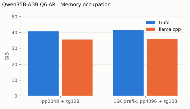

---

<!-- bench:memory-q8 -->
| Qwen35B-A3B Q8 AR Workload | Gufo GiB | llama.cpp GiB | Gain |
| --- | ---: | ---: | ---: |
| pp2048 + tg128 | 46.74 | 41.46 | -11.3% |
| 16K prefix, pp4096 + tg128 | 47.74 | 41.64 | -12.8% |
<!-- /bench -->

---

<!-- bench:memory-q4km -->
| Qwen35B-A3B Q4_K_M AR Workload | Gufo GiB | llama.cpp GiB | Gain |
| --- | ---: | ---: | ---: |
| pp2048 + tg128 | 30.04 | 25.59 | -14.8% |
| 16K prefix, pp4096 + tg128 | 31.04 | 25.77 | -17.0% |
<!-- /bench -->

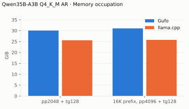

---

## A second machine: ASUS ProArt PX13 laptop

These rows are not produced by the harness above and are deliberately left
outside the marked blocks: they come from a different box and a different
serving path, so the rendered tables keep their bond to the artifacts.

AMD Strix Halo again, in a laptop: an ASUS ProArt PX13 (HN7306EAC), Ryzen AI
Max+ 395 with the Radeon 8060S (`gfx1151`), 121 GiB of unified memory, running
the `performance` power profile. Same GPU family as the desktop above, a
laptop power envelope.

The drafted rows are gufo `5faa653b`, the head of
[#299](https://github.com/gufo-org/gufo/pull/299) — the branch that adds
`qwen35moe` — compiled in place against this box's ROCm 7.2.4 userland rather
than the pinned 7.2.3, so these numbers are not toolchain-matched to the tables
above. It also predates `03d06ea`, the MMQ K-quant expert decode change. The
target is a derivative whose routed experts are Q6_K and Q8_0, so how far that
change moves this file depends on which projection carries which format.

Requests went through an OpenAI-compatible router (llama-swap) with a single
slot serving the model at `--sessions 1`, and the numbers below are the
server's per-request counters (`prefill_tps`, `decode_tps`, `ttft_ms`) rather
than `tools/bench/model-bench.py` output. Greedy, one request in flight, two
reps per cell, spread is the difference between them. Prefill is cold by
construction — a fresh prompt body per probe and `cache_prompt: false` — so
there is no warm-cache row here. *Requested* is the prompt size asked for,
*counted* is what the server tokenized; the probe overshoots by a few per cent,
so the measured column is the one to quote.

Prefill, cold:

| Requested tokens | Counted tokens | Gufo pp (tok/s) | Spread | TTFT (ms) |
| ---: | ---: | ---: | ---: | ---: |
| 512 | 639 | 1431.5 | 45.2 | 452 |
| 2,048 | 2,292 | 1983.2 | 1.2 | 1,159 |
| 8,192 | 8,928 | 2240.2 | 1.5 | 3,990 |
| 32,768 | 35,389 | 1939.8 | 5.3 | 18,251 |

Decode, DFlash2 draft on (aminya's Q8_0 conversion, not byte-identical to the
draft used here — see [the derivative note](README.md#tested-derivatives)):

| Depth (tokens) | Counted tokens | Gufo tg (tok/s) | Spread | Draft accept (%) | TTFT (ms) |
| ---: | ---: | ---: | ---: | ---: | ---: |
| 0 | 78 | 88.2 | 12.4 | 81 | 224 |
| 4,096 | 4,504 | 52.5 | 1.6 | 49 | 2,110 |
| 32,768 | 35,389 | 50.5 | 6.3 | 56 | 18,330 |

Plain, same file and same box, on the current `staging` build (`03d06ea` — the
MMQ K-quant expert decode change, which is the change that touches this file's
Q6_K experts), served by the engine directly rather than through the router:

| Requested tokens | Counted tokens | Gufo pp (tok/s) | Spread | TTFT (ms) |
| ---: | ---: | ---: | ---: | ---: |
| 512 | 639 | 1521.2 | 56.7 | 423 |
| 2,048 | 2,292 | 2071.2 | 5.7 | 1,109 |
| 8,192 | 8,928 | 2287.6 | 18.5 | 3,907 |
| 32,768 | 35,389 | 1982.7 | 7.6 | 17,854 |

| Depth (tokens) | Counted tokens | Gufo tg (tok/s) | Spread | TTFT (ms) |
| ---: | ---: | ---: | ---: | ---: |
| 0 | 78 | 43.6 | 0.2 | 211 |
| 4,096 | 4,504 | 43.4 | 0.2 | 2,059 |
| 32,768 | 35,389 | 39.8 | 0.4 | 17,886 |

Both decode arms generate 128 tokens per probe, so the two decode tables differ
only in the draft. Plain decode barely moves with context on this box — 43.6
from an empty prompt against 39.8 at 32K, 9% across the whole range — so the
drafted fall from 88.2 to 50.5 is draft acceptance dropping (81% to 56%) rather
than the base rate collapsing underneath it. DFlash2 is worth 2.02x at empty
context here, 1.21x at 4K and 1.27x at 32K. Those three ratios cross a build
(`5faa653b` drafted against `03d06ea` plain) and a serving path, so treat them
as an upper bound on the draft's own contribution until both arms run on one
binary.

Prefill moved the other way between the same two runs: +6.3% at 512, +4.4% at
2,048, +2.1% at 8,192, +2.2% at 32,768 — the same sign in all four cells, which
is the shape the MMQ expert path predicts and not one noise usually keeps to
itself. It is still not an isolated A/B: build, toolchain patch level and
serving path all differ between the two tables.

Against the desktop tables — same GPU family at 128 GB, pinned toolchain,
UD-Q6_K_XL — the laptop keeps 79% of the desktop's plain decode at empty
context (43.6 against 55.05), 81% at 4K (43.4 against 53.78) and 84% at 32K
(39.8 against 47.41). Cold prefill falls further behind: 2071.2 against
3089.57, two thirds of the desktop, which is where a laptop power envelope
shows up first. The targets are not the same file either, so read these as
Strix Halo in a laptop rather than as a desktop-to-laptop ratio.

One caveat on the drafted rows above. That run's environment record logged the
source tree as `main` for the two 32K cells: a branch restore had already moved
the checkout, and the invocation recorded the tree rather than the executable.
All seven drafted cells come from one `5faa653b` build — the restore's binary
copy landed at 21:47:03.269, 94 ms after the run wrote its table, and the
`main` build that replaced it refuses this file outright with
`Missing required Qwen tensor: blk.0.ffn_gate.weight`. The plain run has no
such ambiguity: it recorded the executable it served, and that checkout's code
is `03d06ea` with documentation-only changes on top.
